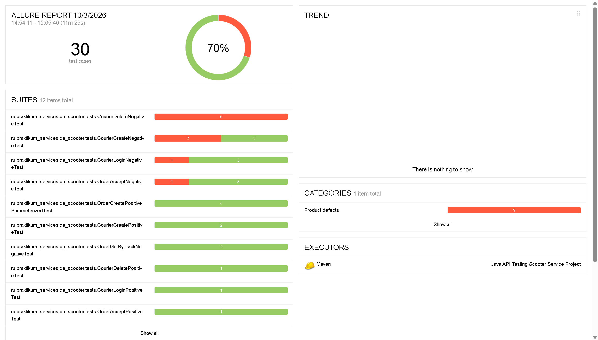
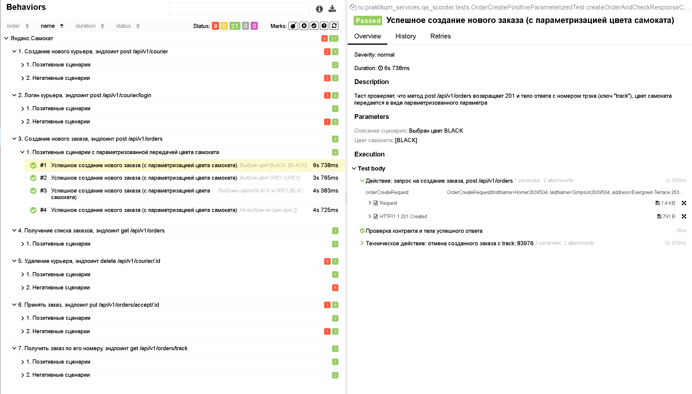
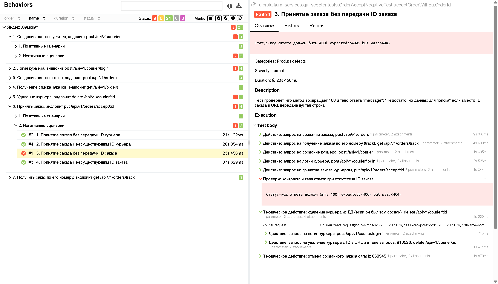

# Java API Testing Scooter Service Project

**Контекст и цели проекта**: проектирование масштабируемой и отказоустойчивой архитектуры фреймворка автоматизации API-тестов (REST Client Architecture) для верификации критических бизнес-цепочек бэкенда и контрактной валидации данных.

**ТЗ (вид работ)**: автоматизация бэкенда (REST API Automation), построение паттерна изолированных клиентов, проектирование динамических POJO/DTO моделей данных (Lombok/Gson), реализация безопасного жизненного цикла данных (Data CleanUp), интеграция BDD-репортинга Allure.

**Продукт**: REST-бэкенд сервиса проката Яндекс.Самокат.

**Выполненные задачи**:
1. **Архитектура REST-клиентов (HTTP Layer)**: разработан базовый класс `BaseClient` с централизованной конфигурацией `RequestSpecification` и автоматической инжекцией Allure-фильтра (`AllureRestAssured`). Спроектированы изолированные классы-клиенты `CourierClient` и `OrderClient`, полностью инкапсулирующие логику вызова эндпоинтов и возвращающие сырые HTTP-ответы `Response` для последующего контрактного анализа.
2. **Управление данными и POJO/DTO**: реализована объектная модель запросов посредством библиотек **Lombok** (`@Data`, `@AllArgsConstructor`) и **Gson** (`@SerializedName`). Устранён избыточный шаблонный код геттеров/сеттеров. Спроектирован полиморфный конструктор для `CourierDeleteRequest(Object id)`, обеспечивающий безопасную передачу невалидных или отсутствующих типов данных в негативных тест-кейсах.
3. **Динамическая генерация и изоляция (Data Layer)**: внедрены генераторы тестовых данных `CourierDataGenerator` и `OrderDataGenerator`. За счёт интеграции таймстампов системы (`System.currentTimeMillis()`) и динамического расчёта времени `LocalDate` обеспечена гарантированная уникальность сущностей, предотвращающая Flaky-эффекты и конфликты в БД при параллельном запуске.
4. **Интеграционные цепочки вызовов (Chain Calls)**: для верификации ручек принятия заказа реализована сложная многоуровневая подготовка предусловий: генерация и регистрация курьера -> создание заказа -> извлечение `track` -> получение `order.id` по треку -> авторизация курьера -> вызов метода связывания сущностей.
5. **Безопасный жизненный цикл (CleanUp)**: в блоках `@After` реализована логика безусловной очистки БД стенда от тестовых сущностей (`actionCourierDeleteIfCreated`, `actionOrderCancelIfCreated`). Код снабжён проверками на `null` и перехватом исключений `try-catch`, что гарантирует чистоту окружения даже в случае досрочного падения логики теста.
6. **Многоуровневый BDD-репортинг (Allure)**: тест-инфраструктура полностью размечена аннотациями `@Epic`, `@Feature`, `@Story`, `@Description` для иерархического структурирования отчётов Allure. Внедрены лямбда-шаги `Allure.step` для изоляции проверок, а также метод `Allure.parameter` для динамического вывода параметров в Allure-дашборд в рамках параметризованного тест-комплекта `OrderCreatePositiveParameterizedTest`.

**Область тестирования (Scope)**: позитивные и негативные сценарии регистрации, авторизации и удаления курьеров, параметризованная валидация создания заказов (перебор массивов цветов), логика получения списков и фильтрации заказов по трек-номерам, обработка граничных условий (Missing/Null Body в JSON, пустые строки в URL).

**Окружение**: Java (JDK 11), JUnit 4, RestAssured, Lombok, Gson, Allure Reporting, AspectJ Weaver Agent, Maven.

### Визуализация тестового репортинга Allure & Root Cause Analysis

#### 1. Общий дашборд метрик выполнения (Overview Dashboard)
Прогон тест-комплекта демонстрирует стабильное выполнение и прозрачное распределение результатов по категориям.

#### 2. Иерархическая структура BDD-сценариев (Behaviors Tree)
Развёрнутая структура параметризованного тест-кейса `OrderCreatePositiveParameterizedTest`. Благодаря интеграции метода `Allure.parameter()` каждый сценарий динамически изолирован в отчёте с отображением конкретных конфигураций цвета самоката.

#### 3. Обнаруженный дефект бэкенда (Defect Documentation: HTTP 404 vs 400)
В ходе выполнения негативного сценария `acceptOrderWithoutOrderId` (принятие заказа без передачи ID заказа) был локализован дефект бизнес-логики: сервер возвращает статус-код `404 Not Found` вместо ожидаемого по ТЗ контракта `400 Bad Request`. Тест задокументирован как упавший (`Failed`) для демонстрации работы репортинга.

